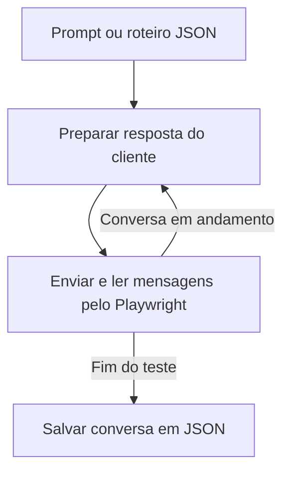

# ChatProbe

O ChatProbe testa assistentes virtuais pela interface web. Ele simula um cliente com base em um prompt ou roteiro JSON e registra as mensagens e as respostas do bot para revisão.

O roteiro JSON foi validado em homologação pelo terminal. O aplicativo Windows roda nos modos **Roteiro JSON**, **Groq** e **Ollama**, com testes simultâneos e uma fila de prompts para execução em segundo plano.

Consulte o [mapa de andamento](docs/status-do-projeto.md) para ver as validações e as próximas entregas.

## Interface desktop

As abas **Teste**, **Fila de testes** e **Configurações** ficam à esquerda do cabeçalho. A versão aparece à direita, sob o nome ChatProbe. O [guia da interface](docs/fase-4-interface.md) reúne capturas dos temas, atalhos e a validação no Windows.

## Aplicativo para Windows

Na pasta do projeto, abra o **PowerShell do Windows** com o Python para Windows disponível e rode:

```powershell
.\build-windows.ps1
```

O script prepara o ambiente, instala o Chromium e gera `dist\ChatProbe\ChatProbe.exe`. Se o Python estiver disponível pelo comando `py`, use `.\build-windows.ps1 -Python py`. Para nomear a pasta da versão, use `-OutputDirectory 'dist/nome-da-versao'`. Para executar em outro computador Windows, copie a pasta `ChatProbe` inteira, incluindo `_internal`.

O recurso de versão do executável e a tag da interface vêm do arquivo `VERSION`. Após cada build bem-sucedido, `dist` fica com o novo pacote e até dois pacotes anteriores. Quando o destino já tem um pacote do ChatProbe, o script guarda a versão substituída em uma pasta `anterior-*` antes de publicar a nova.

### Configurar e executar um teste

1. Em **Configurações → Aplicação**, salve a URL HTTP ou HTTPS do ambiente de teste e informe o nome padrão. O portal de homologação atual é o padrão. Em **Configurações → Provedores de IA**, selecione o modo de execução e o modelo ou chave, quando aplicável.
2. Na aba **Teste**, selecione o **Produto**, informe a quantidade de testes e quantos podem rodar simultaneamente. Cole um **Prompt inicial** ou um **Roteiro JSON**, conforme o modo.
3. Clique em **Iniciar teste**. Ao encerrar o lote, selecione um item no campo **Resultado**. Você pode selecionar partes da conversa, copiar o texto completo, ampliar o painel, abrir a pasta de relatórios ou exportar uma cópia em JSON.

| Modo | Entrada | Configuração |
| --- | --- | --- |
| **Groq** | Prompt em linguagem natural | Chave da Groq e modelo `openai/gpt-oss-20b`. É a seleção inicial no Windows. |
| **Ollama** | Prompt em linguagem natural | Modelo instalado no Ollama local. |
| **Roteiro JSON** | Mensagem inicial e passos condicionados às respostas | Use o [roteiro de exemplo](examples/prompts/cupom-nao-impresso.json) ou cole seu próprio JSON. |

Nos modos Groq e Ollama, **Máx. mensagens do cliente** controla o limite de cada sessão. O padrão é seis e inclui o nome quando o chatbot o solicita. O modelo pode encerrar antes se o objetivo for atingido. Em lotes que repetem um prompt, o ChatProbe solicita aberturas diferentes para o mesmo cenário. Confirmações como **Ok**, **Feito**, **Sim** e **Certo** podem se repetir quando o bot avança para outra etapa. O retorno a uma etapa já respondida pode encerrar a conversa por loop.

O nome e o produto iniciais são **Pedro Teste Automatizado** e **AUTOSYSTEM**. A triagem envia o CNPJ de teste, seleciona **Suporte Técnico** e escolhe o produto. Se o chatbot listar casos em aberto, o ChatProbe seleciona **Outro assunto**. Quando solicitado, envia o nome configurado. No modo JSON, o envio acontece no passo correspondente do roteiro.

Em **Configurações → Armazenamento**, use **Escolher pasta** para definir o destino dos relatórios. O padrão no Windows é `%USERPROFILE%\ChatProbe\Resultados`. O aplicativo lembra a pasta, o modo, o modelo Ollama, o nome do cliente e o tema entre sessões.

Em **Configurações → Provedores de IA → Chaves de API existentes**, selecione o provedor, informe um nome e cole a chave para salvar. Você pode cadastrar várias chaves de Groq, OpenAI, Anthropic ou Google Gemini. A chave que já estava cadastrada aparece como **Padrão**. As chaves ficam no Gerenciador de Credenciais do Windows. Para a Groq, selecione uma chave e clique em **Testar conexão** para validar o acesso à lista de modelos. [Criar uma chave da Groq](https://console.groq.com/keys)

Se a Groq recusar uma chamada por limite de tokens ou de requisições, o ChatProbe interrompe o lote, exibe o motivo e preserva as mensagens capturadas. [Limites da Groq](https://console.groq.com/docs/rate-limits)

### Executar com Ollama

1. Abra o Ollama no mesmo computador que executa o ChatProbe. Se precisar instalar um modelo, execute `ollama pull qwen3:4b`.
2. Em **Configurações → Provedores de IA**, selecione **Ollama** no campo **Modo** e escolha um modelo instalado em **Modelo Ollama**.
3. Preencha o **Prompt inicial**, defina **Máx. mensagens do cliente** e clique em **Iniciar teste**. Comece com um teste simultâneo para conferir o tempo de resposta do modelo.

O ChatProbe acessa o Ollama em `http://127.0.0.1:11434` e gera as mensagens do cliente sem chave de API. O Chromium usa a rede para acessar o chat de homologação. [Instalar o Ollama](https://ollama.com/download)

### Fila de testes

Na aba **Fila de testes**, escreva um prompt inicial e clique em **Adicionar à fila**. Repita para cada cenário. Escolha um título opcional, use **Ampliar editor** para prompts longos e salve as alterações. **Subir** e **Descer** mudam a ordem da fila preservando o texto. A fila fica salva e usa o modo, o modelo e o nome definidos em **Configurações**. No modo JSON, adicione um roteiro por item.

Clique em **Executar fila** para iniciar um teste por item, com o Chromium em segundo plano. Mantenha o computador acordado durante a execução. O JSON é atualizado a cada teste encerrado. Use **Ver conversas** para abrir os resultados no aplicativo.

Nas abas de execução, **Pausar** suspende novos testes e interações em pontos seguros. **Retomar** revalida as cotas. **Parar** cancela as esperas e preserva as conversas capturadas e os itens pendentes. Use **Controle de execução** para ajustar intervalos, cotas e tentativas. A fila também pode ser agendada ou recuperada pelo SQLite. Consulte o [guia da Fase 3](docs/fase-3-execucao.md).

Para rodar a janela desktop diretamente no ambiente do WSL já preparado com Playwright e Chromium, use `python -m app.desktop` na raiz do projeto.

## Configurar provedores de IA

Em **Configurações → Provedores de IA**, cadastre um perfil e selecione um modelo. Use o modo **Provedor de IA** para executar com o perfil padrão ou escolher outro nas abas **Teste** e **Fila de testes**. Há predefinições para APIs compatíveis com Chat Completions, Ollama, Google Gemini e Anthropic Claude. Os adaptadores Gemini e Claude ainda aguardam validação com contas reais. Consulte o [guia da Fase 2](docs/fase-2-provedores.md).

## Interface Streamlit

No WSL, ative o ambiente virtual e abra o ChatProbe:

```bash
source .venv/bin/activate
python -m pip install -r requirements.txt
python -m streamlit run app/app.py --server.address 127.0.0.1
```

A interface usa a mesma URL salva nas preferências do desktop ou o portal padrão. Abra `http://localhost:8501`, use o roteiro de exemplo ou cole seu JSON e clique em **Executar teste**. O Chromium abre durante a execução. Ao terminar, confira a conversa e use **Baixar JSON** para guardar o resultado.

Se o Chromium ainda não estiver instalado, rode `python -m playwright install chromium`. Em uma instalação nova do WSL, também pode ser necessário rodar `python -m playwright install-deps chromium`.

## Exemplo de prompt

Cole este exemplo no editor nos modos **Groq** ou **Ollama**.

```text
Produto: AutoSystem
Tema: Cupom fiscal não impresso após a venda

Cenário: O cliente já reiniciou a impressora.
Mensagem inicial: Finalizei a venda, mas o cupom não saiu.
Fatos do cliente: A venda foi concluída. A impressora já foi
reiniciada. O cupom continua sem sair. Informe o reinício quando
o chatbot perguntar ou sugerir esse procedimento pela primeira vez.

Critérios:
- Depois de saber que a venda foi concluída, o chatbot deve considerar
  essa informação ao orientar o cliente.
- Depois de saber que a impressora já foi reiniciada, o chatbot não
  deve repetir a orientação de reiniciar.
- Se o problema persistir, o chatbot deve orientar como conferir
  a configuração da impressora.

Encerrar: Quando o chatbot orientar a conferência da configuração
ou após 6 mensagens do cliente, o que ocorrer primeiro.
```

Para testar vários cenários em uma fila, adicione cada prompt separadamente. Se o resultado esperado depender de um caminho de menu, de uma regra ou de uma exceção do artigo, inclua esse detalhe no prompt. Confira os critérios na conversa registrada.

## Como funciona



Nos modos **Groq** e **Ollama**, a IA interpreta a resposta do chatbot a cada turno. Ela usa o objetivo do teste, os fatos simulados e o histórico da sessão para decidir entre enviar uma mensagem de texto ou encerrar. O Playwright executa a ação e captura a próxima resposta. O modo **Roteiro JSON** usa regras de texto definidas no roteiro. Todos os modos registram as conversas para revisão.

O **Playwright** abre o navegador, localiza os controles da interface, envia mensagens e captura as respostas. O modo visível ajuda a mapear a página e diagnosticar problemas. No modo `headless`, o navegador roda em segundo plano e o usuário pode continuar usando o computador. Caso seja necessário um login manual, essa etapa pode ser feita em uma janela visível.

Cada teste abre um navegador com contexto próprio. O aplicativo respeita a quantidade de sessões simultâneas informada. A separação dos históricos pelo chatbot ainda precisa ser confirmada em homologação com sessões paralelas.

## Resultados

| Status no JSON | Significado |
| --- | --- |
| `completed` | O teste chegou ao fim do roteiro, ao limite de mensagens ou ao encerramento indicado pelo modelo. Confira `termination_reason` para distinguir os casos. |
| `interrupted` | A conversa parou antes de cumprir um passo do roteiro ou de conseguir uma resposta adequada para avançar. |
| `error` | Uma falha impediu a conclusão do teste. |
| `rate_limited` | O provedor recusou uma chamada por limite de API. |
| `paused` | Uma sessão ativa foi encerrada após outra sessão do mesmo lote atingir o limite de API. |
| `stopped` | O usuário interrompeu a execução com **Parar**. |

O relatório de lote registra o total de testes, a quantidade simultânea, os testes que não iniciaram e as conversas encerradas. O relatório noturno também inclui a fila de prompts na ordem de execução. O campo `termination_reason` distingue conclusão, loop, limite de mensagens, interrupção, erro técnico e limite de API. A aprovação do atendimento depende da revisão dos critérios e das mensagens capturadas.

A conversa exibe horários locais. O JSON registra início, fim, duração em segundos e horários de envio e captura em UTC. O SQLite é criado no primeiro teste ao lado das preferências, em `%LOCALAPPDATA%\ChatProbe\chatprobe.sqlite3` no Windows e normalmente em `~/.config/ChatProbe/chatprobe.sqlite3` no Linux. Ele guarda testes, mensagens e eventos à medida que ocorrem. Os relatórios JSON continuam disponíveis e o banco e os relatórios devem permanecer fora do Git. Consulte o [formato dos relatórios e a validação no Windows](docs/fase-1-fundacao.md).

## Ferramentas

| Ferramenta | Uso |
| --- | --- |
| Python 3.11+ | Motor de execução e integração entre componentes. |
| Playwright e Chromium | Navegação, envio de mensagens e captura de respostas. |
| `unittest` | Testes automatizados do próprio ChatProbe. |
| Groq | Interpretação do objetivo e simulação do cliente no aplicativo Windows. |
| Ollama | Geração local das mensagens do cliente simulado. |
| Streamlit | Interface para colar o prompt, acompanhar a execução e consultar resultados. |

## Estrutura do repositório

| Caminho | Responsabilidade |
| --- | --- |
| `src/chatprobe/browser/` | Navegador, sessões, seletores e ações no chat. |
| `src/chatprobe/scenarios/` | Interpretação do prompt e representação dos cenários e critérios. |
| `src/chatprobe/runner/` | Execução da conversa, histórico da sessão e limites. |
| `src/chatprobe/evaluation/` | Classificação dos critérios e identificação de evidências. |
| `src/chatprobe/storage/` | Persistência e consulta das execuções. |
| `app/` | Interface do usuário. |
| `examples/prompts/` | Exemplos de roteiros para testes. |
| `tests/` | Testes automatizados do projeto. |
| `docs/` | Documentação técnica e registro das decisões. |

Os diretórios começam com arquivos `.gitkeep` para aparecerem no Git desde o primeiro commit.

## Preparar o ambiente no WSL

Use o terminal WSL na pasta do projeto. É necessário ter Python 3.11 ou superior e o módulo `venv` disponível.

```bash
cd '/mnt/d/dev/QA teste bot'
python3 --version
python3 -m venv .venv
source .venv/bin/activate
python -m pip install playwright
python -m playwright install chromium
```

Se o Chromium apontar bibliotecas de sistema ausentes, instale as dependências com `python -m playwright install --with-deps chromium`, se o seu ambiente permitir a instalação de pacotes do sistema.

### Mapear a interface do chat

Use o Codegen em um ambiente autorizado de homologação.

```bash
read -r -p 'URL do chat de homologação: ' CHAT_URL
python -m playwright codegen "$CHAT_URL"
```

O Codegen abre o navegador e o inspetor do Playwright. Faça o login manual, se necessário, e limpe as ações gravadas antes de registrar o fluxo de teste. Com dados fictícios, abra o chat, selecione o produto, envie uma mensagem e aguarde a resposta. Identifique no inspetor o campo de texto, o botão de envio, os elementos que exibem a resposta e, se houver, o sinal de que a resposta terminou. Use esse mapeamento para implementar o controlador.

O primeiro marco técnico é abrir o chat, enviar uma mensagem, capturar a resposta completa e enviar uma segunda mensagem na mesma sessão. Essa etapa usa o Playwright e dispensa uma chave de IA. Para rodar o Codegen no WSL, o ambiente precisa conseguir abrir janelas gráficas.

Mantenha credenciais, arquivos de sessão e relatórios com dados internos fora do Git. Use exemplos fictícios neste repositório.

## Roadmap

- [x] Validar a triagem e uma conversa com roteiro JSON em homologação pelo terminal.
- [x] Implementar a janela desktop, os modos Groq e Ollama e a fila de testes.
- [ ] Validar os modos do aplicativo Windows e o isolamento das sessões simultâneas em homologação.
- [ ] Avaliar critérios e comparar execuções com base nas evidências das conversas.

## Testes automatizados

Na raiz do projeto, execute `python -m unittest discover -s tests -v`.

## Referências

- [Playwright para Python](https://playwright.dev/python/docs/library)
- [Instalação de navegadores no Playwright](https://playwright.dev/python/docs/browsers)
- [Gravador de interações do Playwright](https://playwright.dev/python/docs/codegen)
