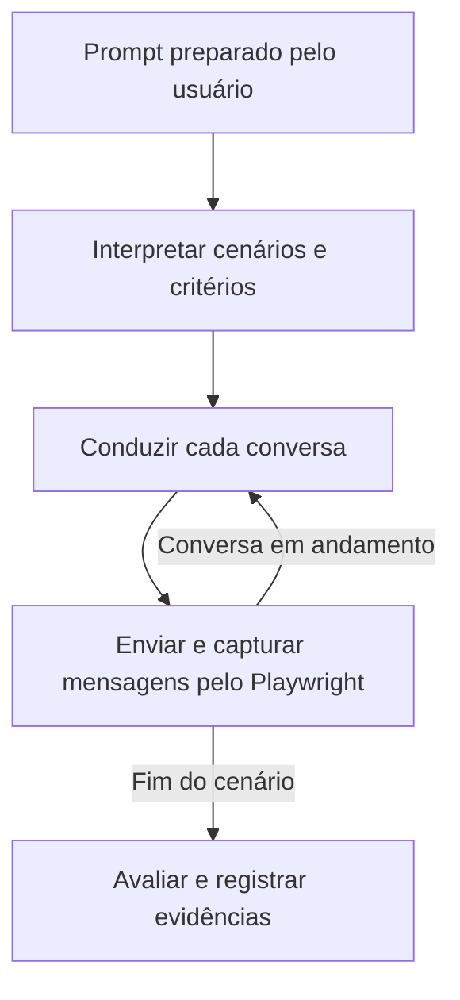

# ChatProbe

Automação de testes de assistentes virtuais pela interface web. O usuário cola um prompt com as orientações do teste. O ChatProbe usa esse prompt para simular clientes, conversar com o chatbot e mostrar evidências do que aconteceu em cada cenário.

**Status:** teste de conversa com roteiro JSON validado em homologação pelo terminal. O aplicativo Windows executa lotes em modo JSON ou Groq e permite escolher quantas sessões rodam ao mesmo tempo. A avaliação automática dos critérios está prevista.

Consulte o [mapa de andamento](docs/status-do-projeto.md) para ver as validações e as próximas entregas.

## Aplicativo para Windows

Na pasta do projeto, abra o **PowerShell do Windows** com o Python para Windows disponível e rode:

```powershell
.\build-windows.ps1
```

O script prepara o ambiente de build, baixa o Chromium e gera `dist\ChatProbe\ChatProbe.exe`. Se o Python estiver disponível pelo comando `py`, use `.\build-windows.ps1 -Python py`.

Abra o executável e configure a aba **Teste**. Selecione **Roteiro JSON** para executar o exemplo ou seu próprio roteiro, ou **Groq** para escrever um objetivo em português. Use **Quantidade de testes** para repetir o mesmo cenário e **Testes simultâneos** para definir quantas sessões podem rodar juntas. Cada teste abre uma sessão de Chromium. Selecione o número do teste para ver a conversa e use **Salvar JSON** para exportar os resultados. Para usar em outro computador Windows, copie toda a pasta `dist\ChatProbe`.

Em **Chaves de API**, selecione o provedor, informe um nome e cole a chave para salvar. Você pode cadastrar várias chaves de Groq, OpenAI, Anthropic ou Google Gemini. A chave que já estava cadastrada aparece como **Padrão**. As chaves ficam no Gerenciador de Credenciais do Windows. Para a Groq, selecione uma chave e clique em **Testar conexão** para validar o acesso à lista de modelos. [Criar uma chave da Groq](https://console.groq.com/keys)

No modo **Groq**, selecione a chave para o lote e clique em **Executar teste**. A Groq usa o objetivo e as mensagens da sessão para decidir o que enviar pelo campo de texto ou quando encerrar. O ChatProbe usa `openai/gpt-oss-20b` e encerra cada sessão ao atingir seis mensagens do cliente. Se a Groq recusar uma chamada por limite de tokens ou de requisições, o aplicativo exibe um aviso, pausa o lote e preserva as mensagens capturadas. [Limites da Groq](https://console.groq.com/docs/rate-limits)

Para rodar a janela desktop diretamente no ambiente do WSL já preparado com Playwright e Chromium, use `python -m app.desktop` na raiz do projeto.

## Interface Streamlit

No WSL, ative o ambiente virtual e abra o ChatProbe:

```bash
source .venv/bin/activate
python -m pip install -r requirements.txt
python -m streamlit run app/app.py --server.address 127.0.0.1
```

Abra `http://localhost:8501`, use o roteiro de exemplo ou cole seu JSON e clique em **Executar teste**. O Chromium abre durante a execução. Ao terminar, confira a conversa e use **Baixar JSON** para guardar o resultado.

Se o Chromium ainda não estiver instalado, rode `python -m playwright install chromium`. Em uma instalação nova do WSL, também pode ser necessário rodar `python -m playwright install-deps chromium`.

## Problema e objetivo

Depois de publicar ou atualizar um artigo usado por uma IA de atendimento, é preciso abrir conversas e verificar se ela segue as orientações esperadas. O ChatProbe pretende automatizar essa rotina e permitir a repetição dos mesmos cenários após mudanças no conteúdo.

O primeiro alvo é um ambiente de homologação autorizado. O acesso ao chatbot é pela interface web, que será operada com Python e Playwright.

## Como o usuário vai usar

1. **Preparar o prompt.** Em outra IA, usando um serviço autorizado para o conteúdo do artigo, o usuário pede um roteiro com os cenários, os fatos do cliente simulado e os critérios que deseja validar.
2. **Colar e executar.** Na tela do ChatProbe, o usuário cola o texto no campo **Orientações de teste** e clica em **Executar testes**. Se faltar algo indispensável, como a mensagem inicial ou o comportamento esperado, o aplicativo indica o que precisa ser esclarecido antes de abrir o chat.
3. **Acompanhar.** O aplicativo mostra o cenário em andamento, permite ver a conversa e oferece a opção de interromper a execução.
4. **Conferir.** O usuário abre o resultado de cada cenário e vê os critérios, a conversa e os trechos que justificam a avaliação. O histórico permite reutilizar o mesmo prompt em uma próxima execução.

### Exemplo de prompt para colar

O ChatProbe vai aceitar orientações em linguagem natural. Este formato é uma referência para a IA que prepara o roteiro.

```text
Produto: AutoSystem
Tema: Cupom fiscal não impresso após a venda

Cenário: O cliente já reiniciou a impressora.
Mensagem inicial: Finalizei a venda, mas o cupom não saiu.
Fatos do cliente: A venda foi concluída. A impressora já foi
reiniciada. O cupom continua sem sair. Informe o reinício quando
o chatbot perguntar ou sugerir esse procedimento pela primeira vez.

Critérios:
- Depois de saber que a venda foi concluída, o chatbot deve considerar
  essa informação ao orientar o cliente.
- Depois de saber que a impressora já foi reiniciada, o chatbot não
  deve repetir a orientação de reiniciar.
- Se o problema persistir, o chatbot deve orientar como conferir
  a configuração da impressora.

Encerrar: Quando o chatbot orientar a conferência da configuração
ou após 6 mensagens do cliente, o que ocorrer primeiro.
```

Para executar vários cenários, escreva um bloco para cada um. Se o resultado esperado depender de um caminho de menu, de uma regra ou de uma exceção do artigo, inclua esse detalhe no critério ou cole o trecho correspondente. A avaliação se limita ao que foi especificado no prompt e ao que pode ser observado na conversa.

## Como funciona



No modo **Groq**, a IA interpreta a resposta do chatbot a cada turno. Ela usa o objetivo do teste, os fatos simulados e o histórico da sessão para decidir entre enviar uma mensagem de texto ou encerrar. O Playwright executa a ação e captura a próxima resposta. O modo **Roteiro JSON** usa regras de texto definidas no roteiro, e ambos registram as conversas para revisão.

O **Playwright** abre o navegador, localiza os controles da interface, envia mensagens e captura as respostas. O modo visível ajuda a mapear a página e diagnosticar problemas. No modo `headless`, o navegador roda em segundo plano e o usuário pode continuar usando o computador. Caso seja necessário um login manual, essa etapa pode ser feita em uma janela visível.

Cada teste abre um navegador com contexto próprio. O aplicativo respeita a quantidade de sessões simultâneas informada. A separação dos históricos pelo chatbot ainda precisa ser confirmada em homologação com sessões paralelas.

## Resultados

| Status do cenário | Quando usar |
| --- | --- |
| Aprovado | Todos os critérios obrigatórios foram atendidos. |
| Reprovado | Há evidência de que um critério obrigatório foi descumprido. |
| Revisão necessária | Um critério obrigatório ficou sem evidência suficiente ou a resposta é ambígua. |
| Erro de execução | Um problema técnico, como falha de navegação ou de captura, impediu a conclusão do teste. |
| Interrompido | O usuário encerrou o teste antes do fim. |

Um critério fica como **Não verificado** se a conversa não chegar à etapa em que ele se aplica. O histórico deve guardar o cenário, a data da execução, as mensagens, o motivo do encerramento e a evidência associada a cada critério avaliado.

## Ferramentas

| Ferramenta | Uso previsto |
| --- | --- |
| Python 3.11+ | Motor de execução e integração entre componentes. |
| Playwright e Chromium | Navegação, envio de mensagens e captura de respostas. |
| Pytest | Testes automatizados do próprio ChatProbe. |
| Groq | Interpretação do objetivo e simulação do cliente no aplicativo Windows. |
| SQLite | Histórico local dos testes. |
| Streamlit | Interface para colar o prompt, acompanhar a execução e consultar resultados. |

## Estrutura do repositório

| Caminho | Responsabilidade |
| --- | --- |
| `src/chatprobe/browser/` | Navegador, sessões, seletores e ações no chat. |
| `src/chatprobe/scenarios/` | Interpretação do prompt e representação dos cenários e critérios. |
| `src/chatprobe/runner/` | Execução da conversa, histórico da sessão e limites. |
| `src/chatprobe/evaluation/` | Classificação dos critérios e identificação de evidências. |
| `src/chatprobe/storage/` | Persistência e consulta das execuções. |
| `app/` | Interface do usuário. |
| `examples/prompts/` | Exemplos de roteiros para testes. |
| `tests/` | Testes automatizados do projeto. |
| `docs/` | Documentação técnica e registro das decisões. |

Os diretórios começam com arquivos `.gitkeep` para aparecerem no Git desde o primeiro commit.

## Preparar o ambiente no WSL

Use o terminal WSL na pasta do projeto. É necessário ter Python 3.11 ou superior e o módulo `venv` disponível.

```bash
cd '/mnt/d/dev/QA teste bot'
python3 --version
python3 -m venv .venv
source .venv/bin/activate
python -m pip install playwright
python -m playwright install chromium
```

Se o Chromium apontar bibliotecas de sistema ausentes, instale as dependências com `python -m playwright install --with-deps chromium`, se o seu ambiente permitir a instalação de pacotes do sistema.

### Mapear a interface do chat

Use o Codegen em um ambiente autorizado de homologação.

```bash
read -r -p 'URL do chat de homologação: ' CHAT_URL
python -m playwright codegen "$CHAT_URL"
```

O Codegen abre o navegador e o inspetor do Playwright. Faça o login manual, se necessário, e limpe as ações gravadas antes de registrar o fluxo de teste. Com dados fictícios, abra o chat, selecione o produto, envie uma mensagem e aguarde a resposta. Identifique no inspetor o campo de texto, o botão de envio, os elementos que exibem a resposta e, se houver, o sinal de que a resposta terminou. Use esse mapeamento para implementar o controlador.

O primeiro marco técnico é abrir o chat, enviar uma mensagem, capturar a resposta completa e enviar uma segunda mensagem na mesma sessão. Essa etapa usa o Playwright e dispensa uma chave de IA. Para rodar o Codegen no WSL, o ambiente precisa conseguir abrir janelas gráficas.

Mantenha credenciais, arquivos de sessão e relatórios com dados internos fora do Git. Use exemplos fictícios neste repositório.

## Roadmap

- [ ] Mapear a interface em homologação e validar uma conversa de dois turnos.
- [ ] Interpretar um prompt e executar um cenário com limites de tempo e mensagens.
- [ ] Avaliar os critérios e salvar as evidências e o histórico da conversa.
- [ ] Criar a tela para colar o prompt, acompanhar a execução e consultar o resultado.
- [ ] Verificar o isolamento do chatbot e habilitar a execução paralela com limite de sessões.

## Referências

- [Playwright para Python](https://playwright.dev/python/docs/library)
- [Instalação de navegadores no Playwright](https://playwright.dev/python/docs/browsers)
- [Gravador de interações do Playwright](https://playwright.dev/python/docs/codegen)
